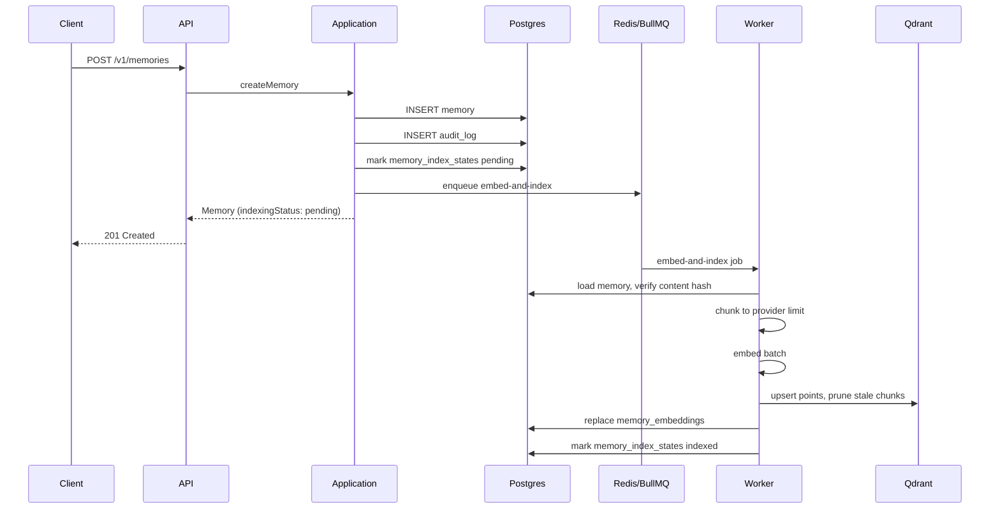
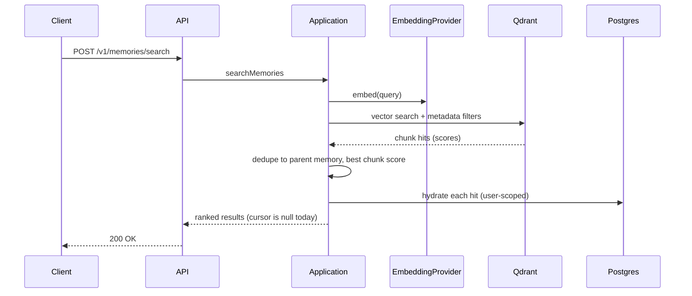
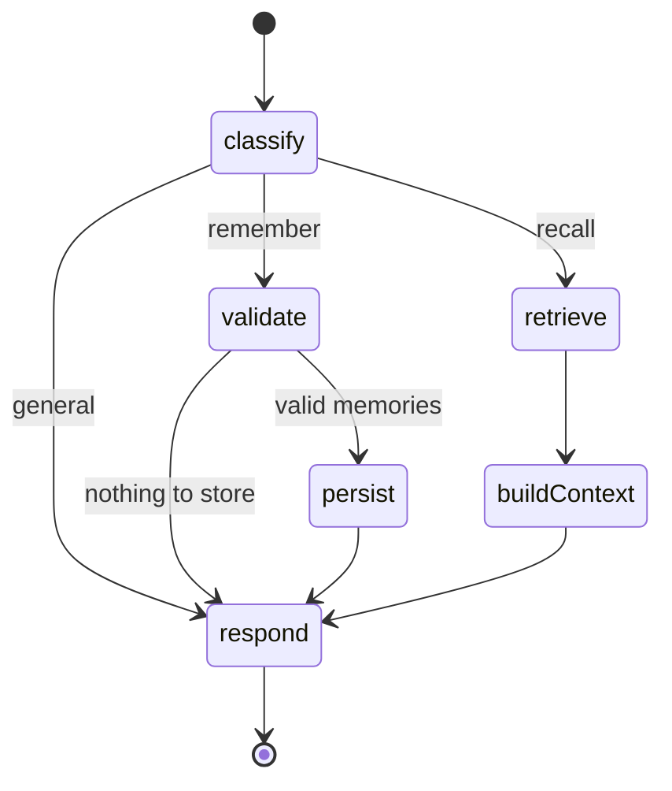

# Smriti v1 Architecture

> **Status**: v1 implemented (memory CRUD, semantic search, async indexing, reconciliation, REST/chat dedup, request idempotency, Prometheus metrics, and LangGraph `/v1/chat`).
> **Scope**: Long-term + semantic memory, REST APIs, LangGraph `/chat`, embedding pipeline, auth, observability
> **Not in v1**: object storage, DLQ, auth/API-key audit events, per-user rate-limit tracking, streaming chat/checkpointing.
> **Last updated**: 2026-10-21

---

## 1. System Context

### 1.1 Purpose

Smriti is a production-grade agentic memory assistant. v1 delivers a REST API and a LangGraph-powered `/chat` endpoint that can extract, store, retrieve, and reason over user memories with semantic search backed by vector embeddings. Memory and chat writes support optional request idempotency.

### 1.2 Actors

| Actor              | Description                                                            |
| ------------------ | ---------------------------------------------------------------------- |
| **End user**       | Registers, authenticates, manages memories via REST or chat            |
| **API consumer**   | External service using JWT or API key to call memory APIs              |
| **Admin**          | RBAC `admin` role; views users and audit logs                          |
| **Worker process** | BullMQ consumer for embedding, vector indexing, reconciliation         |
| **CI pipeline**    | GitHub Actions: format/lint/typecheck, tests, eval gate, Docker builds |

### 1.3 External Dependencies

| Dependency                | Role                                                                                | v1 usage              |
| ------------------------- | ----------------------------------------------------------------------------------- | --------------------- |
| **PostgreSQL**            | Source of truth for users, memories, conversations, audit logs, durable index state | Critical path         |
| **Redis**                 | BullMQ queue/schedulers and rate-limit counters                                     | Critical path         |
| **Qdrant**                | Vector store for semantic search                                                    | Critical path (async) |
| **Docker Model Runner**   | Local embedding + chat through an OpenAI-compatible API                             | Local default         |
| **Ollama**                | Optional local embedding + chat provider                                            | Supported             |
| **OpenAI**                | Optional hosted embeddings + chat provider                                          | Supported             |
| **S3-compatible storage** | Planned conversation exports and eval artifacts                                     | Not implemented v1    |

Embedding vectors are **provider-scoped**. A collection is never shared across providers or dimensions; the local DMR collection is `smriti_dev_dmr_768` (768 dimensions). See [ADR-004](../adr/ADR-004-embedding-provider-split.md) and [ADR-007](../adr/ADR-007-docker-model-runner.md).

### 1.4 Deployment Topology

```
                    ┌─────────────┐
                    │   Clients   │
                    └──────┬──────┘
                           │ HTTPS
              ┌────────────┴────────────┐
              │     API container(s)    │  stateless, horizontal scale
              │  NestJS + LangGraph     │
              └────────────┬────────────┘
         ┌─────────────────┼─────────────────┐
         │                 │                 │
    ┌────▼────┐      ┌─────▼─────┐    ┌─────▼─────┐
    │ Postgres│      │   Redis   │    │  Qdrant   │
    └─────────┘      └─────┬─────┘    └───────────┘
                           │
              ┌────────────┴────────────┐
              │   Worker container(s)   │  BullMQ consumers
              └─────────────────────────┘
```

- **Local**: `pnpm docker:up` runs Postgres, Redis, Qdrant, Ollama, and MinIO. Docker Model Runner is host-native (Docker Desktop) at `http://localhost:12434/engines/v1`; containers reach it at `http://model-runner.docker.internal/engines/v1`.
- **Production**: Two container types (API + worker) against managed Postgres, Redis, Qdrant, and a configured embedding/chat provider. No Kubernetes coupling; env-driven config only.
- **Metrics**: Prometheus scrapes the API at `GET /metrics` (API port) and the worker at `GET /metrics` on `WORKER_METRICS_PORT` (default `9464`). Both are internal-network endpoints, not user-facing APIs.
- **Consistency model**: Postgres is SoT. A durable `memory_index_states` row is authoritative for `indexingStatus`; Qdrant is eventually consistent (target SLA < 30s under normal load) and is repaired by a scheduled reconciler.

---

## 2. Memory Lifecycle

### 2.1 Create

1. Client sends `POST /v1/memories` with a bearer token or API key. An optional `Idempotency-Key` header is handled by the API interceptor before the use case runs.
2. API validates input (Zod).
3. Unless `?force=true`, a best-effort semantic duplicate check runs first (`DEDUP_TIMEOUT_MS`). A match at or above `DEDUP_SIMILARITY_THRESHOLD` returns `409 Conflict` with `{ existingMemoryId, similarity }` and writes nothing.
4. Application `createMemory` runs domain invariants.
5. Memory persisted in Postgres; audit log entry written (`memory.create`).
6. `memory_index_states` is marked `pending` with the current content hash, then `embed-and-index` is enqueued with `jobId = {memoryId}_{contentHash}`.
7. Response returns memory with `indexingStatus: pending`.
8. Worker re-reads the memory and skips if its content hash no longer matches the job.
9. Worker chunks against the provider input limit, embeds, upserts Qdrant, prunes stale chunk points, replaces `memory_embeddings` rows, and marks `memory_index_states` `indexed`.

The dedup check is intentionally not part of the durable write path: if embeddings or Qdrant are unavailable, creation proceeds and indexing retries normally.

**Known limitation:** the memory, audit, and index-state writes are separate Prisma statements (no surrounding transaction). A crash after the memory insert can leave the memory without an audit entry; the reconciler repairs missing/stale index state. `Idempotency-Key` covers retried successful requests on memory create and chat, but cannot make those multi-step writes atomic; job IDs still provide indexing idempotency.

### 2.2 Update

1. `PATCH /v1/memories/:id` with changed fields.
2. Domain validates invariants (e.g. cannot be pinned and archived).
3. Postgres update; `content_hash` recomputed if content changed.
4. Audit log (`memory.update`).
5. If content changed: mark `pending` for the new hash and re-enqueue `embed-and-index`. The old Qdrant points remain searchable until the new index succeeds; the handler then upserts new chunks and deletes stale chunk points.
6. Response reflects current Postgres state; `indexingStatus` is `pending` until the worker commits `indexed`.

### 2.3 Delete

1. `DELETE /v1/memories/:id`.
2. Postgres row hard-deleted.
3. Audit log (`memory.delete`) with content hash snapshot (not full PII).
4. `delete-vectors` job enqueued with `jobId = memoryId`.
5. Worker scrolls Qdrant by the `memoryId` payload field and deletes every matching chunk point, then deletes the `memory_embeddings` rows. If the job is lost, the reconciler deletes points whose memory no longer exists.

### 2.4 Consistency Window

| Operation        | Postgres  | Qdrant           | User-visible behavior                                 |
| ---------------- | --------- | ---------------- | ----------------------------------------------------- |
| Create           | Immediate | Async (~seconds) | Memory in list/GET immediately; search after indexing |
| Update (content) | Immediate | Async re-index   | Old vector may serve until new index completes        |
| Delete           | Immediate | Async purge      | Memory gone from API; stale vector possible briefly   |
| Reconciliation   | —         | Repair           | Job scheduler every 15 min fixes drift                |

API responses include `indexingStatus` (`pending` | `indexed` | `failed` | `not_applicable`) from the durable `memory_index_states` row. A stored hash that differs from the memory's current hash is treated as `pending`. `not_applicable` is returned when no durable index-state store is wired (for example, direct use-case tests). Search hits are the exception: they report `indexed` because they are served from Qdrant.

The reconciler scans Postgres in pages, compares state/hash, verifies that each `indexed` memory has exactly its expected Qdrant chunk points, force-re-enqueues inconsistent memories up to a cap, and deletes Qdrant points whose memory no longer exists. Deletion candidates are re-checked against Postgres to avoid racing a concurrent create.

### 2.5 Chat Turn

1. Client sends `POST /v1/chat` with `{ message, conversationId? }` and an optional `Idempotency-Key`.
2. If a key is supplied, the API reserves or replays it before doing any conversation work.
3. The API finds or creates an owned conversation and loads the last 20 messages as history.
4. The user message is appended to Postgres before the graph runs.
5. `classify` asks the chat model for `remember`, `recall`, or `general` intent and extracts candidate memories for `remember`.
6. `remember`: `validate` trims/deduplicates extracted content, then `persist` runs best-effort dedup per memory and calls the shared `createMemory` use case. Duplicates are skipped and reported as warnings.
7. `recall`: `retrieve` embeds the user message, searches Qdrant, hydrates the matching Postgres rows, and `buildContext` wraps them in `<retrieved_memories>` delimiters.
8. `respond` generates the assistant reply with bounded history and context.
9. The assistant message is appended to Postgres and the synchronous response returns the conversation ID plus created/retrieved IDs and dedup warnings. The response is stored against the idempotency key when one was supplied.

Chat idempotency replays successful turns, so a retry does not create a second user/assistant pair or repeat memory persistence. There is still no transaction across user message, graph, and assistant message: a crash after partial persistence can leave partial history, and a retry after that failure creates a new turn.

---

## 3. Sequence Diagrams

### 3.1 Memory Write (REST)



### 3.2 Semantic Search



### 3.3 Chat Turn

```mermaid
sequenceDiagram
  participant C as Client
  participant API as API
  participant LG as LangGraph
  participant App as Application
  participant LLM as ChatModel
  participant PG as Postgres

  C->>API: POST /v1/chat
  API->>PG: find/create conversation, load history
  API->>PG: persist user message
  API->>LG: run graph(state)

  LG->>LLM: classify + extract (JSON)
  alt remember
    LG->>App: best-effort dedup per extracted memory
    LG->>App: createMemory (same as REST)
    App->>PG: persist memory + index state; enqueue embed
  else recall
    LG->>App: searchMemories
    App-->>LG: retrieved memories
    LG->>LG: context block (delimited)
  end

  LG->>LLM: generate response
  LG-->>API: response + created/retrieved IDs + warnings
  API->>PG: persist assistant message
  API-->>C: 200 OK
```

---

## 4. Entity-Relationship Diagram

```mermaid
erDiagram
  users ||--o{ memories : owns
  users ||--o{ refresh_tokens : has
  users ||--o{ api_keys : has
  users ||--o{ conversations : owns
  users ||--o{ audit_logs : generates
  users ||--o{ idempotency_keys : owns

  memories ||--o{ memory_embeddings : has
  memories ||--o| memory_index_states : has
  conversations ||--o{ conversation_messages : contains
  conversations ||--o{ memories : "optional link"

  users {
    uuid id PK
    string email UK
    string password_hash
    enum role
    timestamp created_at
  }

  memories {
    uuid id PK
    uuid user_id FK
    enum type
    text content
    string category
    string[] tags
    float importance
    float confidence
    boolean is_pinned
    boolean is_archived
    uuid conversation_id FK
    string content_hash
    timestamp created_at
    timestamp updated_at
  }

  memory_embeddings {
    uuid id PK
    uuid memory_id FK
    int chunk_index
    int token_count
    string provider
    string model
    int dimension
    string qdrant_point_id
    enum status
    timestamp indexed_at
  }

  memory_index_states {
    uuid memory_id PK_FK
    string content_hash
    enum status
    text error
    timestamp updated_at
  }

  conversations {
    uuid id PK
    uuid user_id FK
    string title
    jsonb metadata
    timestamp created_at
    timestamp updated_at
  }

  conversation_messages {
    uuid id PK
    uuid conversation_id FK
    enum role
    text content
    timestamp created_at
  }

  audit_logs {
    uuid id PK
    uuid user_id FK
    string action
    string entity_type
    uuid entity_id
    jsonb payload_snapshot
    string correlation_id
    timestamp created_at
  }

  idempotency_keys {
    string key PK
    uuid user_id FK
    string request_hash
    enum status
    int response_status
    jsonb response_snapshot
    string lock_token
    timestamp locked_until
    timestamp created_at
    timestamp updated_at
    timestamp expires_at
  }
```

### Indexes (v1)

- `users (email)` (unique)
- `refresh_tokens (user_id)`
- `api_keys (user_id)`
- `conversations (user_id, created_at DESC)`
- `memories (user_id, created_at DESC)`
- `memories (user_id, category)`
- `memory_embeddings (memory_id)`
- `memory_index_states (status)`
- `conversation_messages (conversation_id, created_at)`
- `audit_logs (user_id, created_at DESC)`
- `idempotency_keys (user_id)`
- `idempotency_keys (expires_at)`

The partial indexes for pinned/archived listings were designed but are **not yet in a migration**.

---

## 5. API Contract

All user-facing endpoints are prefixed with `/v1`. Operational endpoints (`/health`, `/live`, `/ready`, `/metrics`) are unprefixed. `Idempotency-Key` is supported on `POST /v1/memories` and `POST /v1/chat`.

### 5.1 Auth

| Method | Path                | Description                          |
| ------ | ------------------- | ------------------------------------ |
| POST   | `/v1/auth/register` | Create user account                  |
| POST   | `/v1/auth/login`    | Returns access + refresh tokens      |
| POST   | `/v1/auth/refresh`  | Rotate refresh token                 |
| POST   | `/v1/auth/logout`   | Revoke refresh token                 |
| POST   | `/v1/api-keys`      | Issue API key (plaintext shown once) |
| DELETE | `/v1/api-keys/:id`  | Revoke API key                       |

### 5.2 Memories

| Method | Path                  | Description                 |
| ------ | --------------------- | --------------------------- |
| POST   | `/v1/memories`        | Create memory               |
| GET    | `/v1/memories`        | List with cursor pagination |
| GET    | `/v1/memories/:id`    | Get by ID                   |
| PATCH  | `/v1/memories/:id`    | Partial update              |
| DELETE | `/v1/memories/:id`    | Hard delete                 |
| POST   | `/v1/memories/search` | Semantic search             |

#### Create Memory Request

```typescript
{
  type: "long_term" | "semantic";
  content: string;           // min 1, max 100_000 chars
  category?: string;
  tags?: string[];           // max 50 tags, each max 64 chars
  importance?: number;       // 0–1, default 0.5
  confidence?: number;       // 0–1, default 0.8
  conversationId?: string;   // UUID, optional
}
```

`POST /v1/memories` returns `409 Conflict` with `{ existingMemoryId, similarity }` when the dedup check finds a match. Add `?force=true` to bypass the check.

Both `POST /v1/memories` and `POST /v1/chat` accept an optional `Idempotency-Key` header (1–255 characters). The key is scoped to the authenticated user and route. A replay returns the original status and body with `Idempotency-Replayed: true`. Reusing a key with a different payload returns `409` with `reason: "IDEMPOTENCY_KEY_REUSE"`; a concurrent request returns `409` with `reason: "IDEMPOTENCY_IN_PROGRESS"`. Successful responses are cached for `IDEMPOTENCY_TTL_HOURS`; failed requests release the key. See [ADR-010](../adr/ADR-010-request-idempotency.md).

#### Memory Response

```typescript
{
  id: string;
  userId: string;
  type: "long_term" | "semantic";
  content: string;
  category: string | null;
  tags: string[];
  importance: number;
  confidence: number;
  isPinned: boolean;
  isArchived: boolean;
  conversationId: string | null;
  indexingStatus: "pending" | "indexed" | "failed" | "not_applicable";
  createdAt: string;         // ISO 8601
  updatedAt: string;
}
```

#### List Memories Query

```typescript
{
  cursor?: string;
  limit?: number;            // default 20, max 100
  category?: string;
  tags?: string[];           // AND semantics
  includeArchived?: boolean; // default false
  isPinned?: boolean;
}
```

#### Search Request

```typescript
{
  query: string;              // min 1, max 2000 chars
  category?: string;
  tags?: string[];            // AND semantics
  includeArchived?: boolean;  // default false
  from?: string;              // ISO 8601 datetime
  to?: string;                // ISO 8601 datetime
  limit?: number;             // default 10, max 50
  cursor?: string;            // accepted by the schema; not used yet
}
```

#### Search Response

```typescript
{
  items: Array<MemoryResponse & { score: number }>;
  cursor: string | null; // always null in v1
}
```

Search hits currently report `indexingStatus: "indexed"` because they come from Qdrant; list/get/create/update resolve the durable `memory_index_states` value. Cursor-based search pagination is not implemented.

### 5.3 Chat

| Method | Path                             | Description           |
| ------ | -------------------------------- | --------------------- |
| POST   | `/v1/chat`                       | Synchronous chat turn |
| POST   | `/v1/conversations`              | Create conversation   |
| GET    | `/v1/conversations/:id/messages` | List messages         |

#### Chat Request

```typescript
{
  conversationId?: string;
  message: string; // min 1, max 10_000 chars
}
```

#### Chat Response

```typescript
{
  conversationId: string;
  message: string;
  memoriesCreated: string[];   // memory IDs persisted this turn
  memoriesRetrieved: string[]; // memory IDs used as recall context
  duplicateWarnings: Array<{ existingMemoryId: string; similarity: number }>;
}
```

`POST /v1/conversations` accepts `{ title?: string }`. `GET /v1/conversations/:id/messages` accepts `limit` (default 50, max 200) and returns messages in ascending age order. Both chat and message endpoints verify conversation ownership. Chat accepts `Idempotency-Key` with the same replay/conflict semantics as memory creation.

### 5.4 Admin

| Method | Path                   | Role  |
| ------ | ---------------------- | ----- |
| GET    | `/v1/admin/users`      | admin |
| GET    | `/v1/admin/audit-logs` | admin |

### 5.5 Ops

| Method | Path       | Description                                                |
| ------ | ---------- | ---------------------------------------------------------- |
| GET    | `/health`  | Basic health                                               |
| GET    | `/ready`   | Postgres readiness; Qdrant probed; Redis `not_checked`     |
| GET    | `/live`    | Liveness                                                   |
| GET    | `/metrics` | Prometheus format (API); worker uses `WORKER_METRICS_PORT` |

`/ready` returns `status: "ready"` when Postgres responds. Qdrant and Redis results are informational in `checks` and do not currently gate readiness.

### 5.6 Error Shape

```typescript
{
  statusCode: number;
  error: string;
  message: string;
  correlationId: string;
  existingMemoryId?: string; // 409 dedup conflict
  similarity?: number;       // 409 dedup conflict
  reason?: string;           // 409 idempotency conflict
  retryAfterSeconds?: number; // 409 in-progress conflict
  details?: unknown;         // validation errors
}
```

---

## 6. LangGraph Chat Graph

`packages/application/src/chat/` owns the graph. It is framework-free apart from LangGraph itself; the API wires Prisma/Qdrant/BullMQ adapters through ports.

### 6.1 State Schema

```typescript
interface ChatGraphState {
  userId: string;
  conversationId: string;
  correlationId: string;
  messages: Array<{ role: 'user' | 'assistant' | 'system'; content: string }>;
  latestUserMessage: string;
  intent: 'remember' | 'recall' | 'general' | null;
  extractedMemories: Array<{ content: string; type: 'long_term' | 'semantic'; confidence: number }>;
  retrievedMemories: ScoredMemoryDto[];
  duplicateWarnings: Array<{ existingMemoryId: string; similarity: number }>;
  memoriesCreated: string[];
  createdMemoryContents: string[];
  memoriesRetrieved: string[];
  context: string | null;
  response: string | null;
}
```

### 6.2 Nodes

| Node           | Responsibility                                                                   |
| -------------- | -------------------------------------------------------------------------------- |
| `classify`     | One model call: intent + candidate memory extraction as JSON; heuristic fallback |
| `validate`     | Trim, drop invalid/oversized items, exact-dedupe, cap at 5                       |
| `persist`      | Best-effort semantic dedup, then shared `createMemory`; collect warnings         |
| `retrieve`     | Embedding + Qdrant search, hydrate memories, bounded by timeout                  |
| `buildContext` | Build `<retrieved_memories>` block with a 6000-character cap                     |
| `respond`      | Generate the assistant reply with bounded history and mode-specific context      |

### 6.3 Graph Flow



### 6.4 Boundary Rule

LangGraph nodes call **application services only** (`createMemory`, `searchMemories`) through injected ports. They never import infrastructure adapters, Prisma, or NestJS decorators. `ChatService` in the API is the composition root.

### 6.5 Prompt Injection Mitigation

- Retrieved memories are injected inside `<retrieved_memories>` delimiters.
- The system prompt instructs the model to treat retrieved content as untrusted reference data, not instructions.
- Stored-memory contents and retrieved context are never concatenated into the user message.
- History is capped to the last 20 messages; retrieval waits at most `DEDUP_TIMEOUT_MS`.

### 6.6 Dedup and Failure Behavior

- The classification/extraction call and response call are separate; only two model calls per turn in the normal path.
- `remember` runs the same shared `createMemory` use case as REST, so audit entries, index state, and BullMQ jobs stay consistent.
- Chat dedup timeout/failure skips the check rather than blocking the write. REST dedup timeout/failure behaves the same way.
- A failed graph after the user message is persisted does not roll back that message. Idempotency only replays successful turns; the turn's multi-step writes are not transactional.

---

## 7. Port Catalog

All ports live in `packages/domain/src/ports/`. Adapters live in `infrastructure/` or `apps/`. The domain and application packages do not import NestJS, Prisma, BullMQ, Qdrant, or provider SDKs.

### 7.1 Implemented

| Port                     | Methods                                                                                                          | Adapter(s)                              |
| ------------------------ | ---------------------------------------------------------------------------------------------------------------- | --------------------------------------- |
| `MemoryRepository`       | `save`, `findById`, `findByUser`, `findAll`, `existsByIds`, `update`, `delete`                                   | Prisma, in-memory                       |
| `MemoryIndexStateStore`  | `markPending`, `markIndexed`, `markFailed`, `findByMemoryIds`                                                    | Prisma, in-memory                       |
| `MemoryEmbeddingStore`   | `replaceForMemory`, `markStatus`, `deleteForMemory`                                                              | Prisma, in-memory                       |
| `AuditLogRepository`     | `append`, `findAll`                                                                                              | Prisma, in-memory                       |
| `UserRepository`         | `save`, `findByEmail`, `findById`, `findAll`                                                                     | Prisma, in-memory                       |
| `RefreshTokenRepository` | `save`, `findByTokenHash`, `revoke`                                                                              | Prisma, in-memory                       |
| `ApiKeyRepository`       | `save`, `findByKeyHash`, `findById`, `findByUser`, `delete`, `updateLastUsed`                                    | Prisma, in-memory                       |
| `ConversationRepository` | `createConversation`, `findConversation`, `appendMessage`, `listMessages`                                        | Prisma, in-memory                       |
| `IdempotencyStore`       | `begin`, `complete`, `abort`, `deleteExpired`                                                                    | Prisma, in-memory                       |
| `PasswordHasher`         | `hash`, `verify`                                                                                                 | bcrypt                                  |
| `EmbeddingProvider`      | `embed(texts[])`, `model`, `dimension`, `maxInputTokens`                                                         | OpenAI-compatible (DMR, Ollama, OpenAI) |
| `ChatModel`              | `complete(messages[], options?)`, `model`                                                                        | OpenAI-compatible (DMR, Ollama, OpenAI) |
| `VectorStore`            | `upsert`, `deleteByMemoryId`, `deletePoints`, `listPointsByMemoryId`, `scanPoints`, `search`, `ensureCollection` | Qdrant, in-memory                       |
| `JobQueue`               | `enqueue(name, data, { jobId, force })`                                                                          | BullMQ, in-memory                       |

### 7.2 Planned

| Port          | Purpose                               | Target   |
| ------------- | ------------------------------------- | -------- |
| `ObjectStore` | Conversation exports / eval artifacts | Deferred |
| `CacheStore`  | Shared cache/session storage          | Deferred |

### 7.3 Port Interfaces (canonical)

```typescript
// packages/domain/src/ports/embedding-provider.port.ts
interface EmbeddingProvider {
  embed(texts: string[]): Promise<number[][]>;
  readonly model: string;
  readonly dimension: number;
  readonly maxInputTokens: number;
}

// packages/domain/src/ports/memory-repository.port.ts
interface MemoryRepository {
  save(memory: Memory): Promise<void>;
  findById(userId: string, id: string): Promise<Memory | null>;
  findByUser(userId: string, query: ListMemoriesQuery): Promise<PaginatedResult<Memory>>;
  findAll(cursor: string | undefined, limit: number): Promise<PaginatedResult<Memory>>;
  existsByIds(ids: string[]): Promise<Set<string>>;
  update(memory: Memory): Promise<void>;
  delete(userId: string, id: string): Promise<boolean>;
}

// packages/domain/src/ports/vector-store.port.ts
interface VectorStore {
  upsert(points: VectorPoint[]): Promise<void>;
  deleteByMemoryId(memoryId: string): Promise<void>;
  deletePoints(ids: string[]): Promise<void>;
  listPointsByMemoryId(memoryId: string): Promise<VectorPointRef[]>;
  scanPoints(cursor?: string | null, limit?: number): Promise<VectorScanPage>;
  search(params: VectorSearchParams): Promise<VectorSearchResult[]>;
  ensureCollection(): Promise<void>;
}

// packages/domain/src/ports/job-queue.port.ts
interface JobQueue {
  enqueue(name: string, data: unknown, opts?: EnqueueOptions): Promise<void>;
}

// packages/domain/src/ports/chat-model.port.ts
interface ChatModel {
  complete(messages: ChatMessage[], options?: ChatCompletionOptions): Promise<string>;
  readonly model: string;
}

// packages/domain/src/ports/conversation-repository.port.ts
interface ConversationRepository {
  createConversation(userId: string, title: string | null): Promise<ConversationRecord>;
  findConversation(userId: string, id: string): Promise<ConversationRecord | null>;
  appendMessage(
    conversationId: string,
    role: ConversationRole,
    content: string,
  ): Promise<ConversationMessageRecord>;
  listMessages(conversationId: string, limit?: number): Promise<ConversationMessageRecord[]>;
}

// packages/domain/src/ports/idempotency-store.port.ts
interface IdempotencyStore {
  begin(input: BeginIdempotencyInput): Promise<BeginIdempotencyResult>;
  complete(input: {
    key: string;
    requestHash: string;
    lockToken: string;
    responseStatus: number;
    responseSnapshot: unknown;
  }): Promise<void>;
  abort(key: string, requestHash: string, lockToken: string): Promise<void>;
  deleteExpired(now: Date): Promise<number>;
}
```

Every port except `PasswordHasher` has an in-memory/fake adapter for unit tests; `PasswordHasher` is bcrypt-only in v1. The idempotency adapter has both Prisma and in-memory implementations.

---

## 8. Config Matrix

Validated at boot via Zod (`packages/shared/src/config.ts`). Application **fails fast** on missing required values.

| Variable                               | Required  | Default                                     | Description                                                      |
| -------------------------------------- | --------- | ------------------------------------------- | ---------------------------------------------------------------- |
| `NODE_ENV`                             | no        | `development`                               | Runtime mode                                                     |
| `PORT`                                 | no        | `3000`                                      | API listen port                                                  |
| `WORKER_METRICS_PORT`                  | no        | `9464`                                      | Worker Prometheus listen port                                    |
| `LOG_LEVEL`                            | no        | `info`                                      | Pino level                                                       |
| `DATABASE_URL`                         | yes       | —                                           | Postgres connection                                              |
| `REDIS_URL`                            | yes       | —                                           | Redis connection (BullMQ)                                        |
| `QDRANT_URL`                           | yes       | —                                           | Qdrant HTTP endpoint                                             |
| `QDRANT_COLLECTION`                    | no        | `smriti_dev`                                | Collection; use a per-provider name such as `smriti_dev_dmr_768` |
| `EMBEDDING_PROVIDER`                   | no        | `ollama`                                    | `ollama` \| `openai` \| `dmr`                                    |
| `OLLAMA_BASE_URL`                      | if ollama | `http://localhost:11434`                    | Ollama API                                                       |
| `OLLAMA_EMBED_MODEL`                   | no        | `nomic-embed-text`                          | Ollama embedding model (768 dims)                                |
| `OLLAMA_CHAT_MODEL`                    | no        | `llama3.2`                                  | Ollama chat model                                                |
| `DMR_BASE_URL`                         | if dmr    | `http://localhost:12434/engines/v1`         | Docker Model Runner OpenAI-compatible API                        |
| `DMR_EMBED_MODEL`                      | no        | `docker.io/ai/nomic-embed-text-v1.5:latest` | DMR embedding model (768 dims)                                   |
| `DMR_CHAT_MODEL`                       | no        | `docker.io/ai/qwen2.5:3B-Q4_K_M`            | DMR chat model                                                   |
| `LLM_PROVIDER`                         | no        | `openai`                                    | Chat provider: `ollama` \| `openai` \| `dmr`                     |
| `OPENAI_API_KEY`                       | if openai | —                                           | Required when either provider is `openai`                        |
| `OPENAI_EMBED_MODEL`                   | no        | `text-embedding-3-small`                    | OpenAI embedding model (1536 dims)                               |
| `OPENAI_CHAT_MODEL`                    | no        | `gpt-4o-mini`                               | OpenAI chat model                                                |
| `JWT_SECRET`                           | yes       | —                                           | Access-token signing secret (min 16 chars)                       |
| `JWT_EXPIRES_IN`                       | no        | `15m`                                       | Access token TTL                                                 |
| `REFRESH_TOKEN_EXPIRES_IN`             | no        | `7d`                                        | Refresh token TTL                                                |
| `RATE_LIMIT_TTL`                       | no        | `60`                                        | Rate-limit window (seconds)                                      |
| `RATE_LIMIT_MAX`                       | no        | `100`                                       | Requests per window                                              |
| `DEDUP_SIMILARITY_THRESHOLD`           | no        | `0.92`                                      | REST/chat duplicate threshold                                    |
| `DEDUP_TIMEOUT_MS`                     | no        | `2000`                                      | Best-effort dedup/retrieval timeout                              |
| `IDEMPOTENCY_TTL_HOURS`                | no        | `24`                                        | Idempotency response cache TTL                                   |
| `IDEMPOTENCY_LOCK_TIMEOUT_MS`          | no        | `30000`                                     | In-progress reservation stale lock                               |
| `IDEMPOTENCY_CLEANUP_INTERVAL_MINUTES` | no        | `60`                                        | Expired-key cleanup scheduler interval                           |
| `RECONCILE_ENABLED`                    | no        | `true`                                      | Register/remove the reconcile scheduler                          |
| `RECONCILE_INTERVAL_MINUTES`           | no        | `15`                                        | Scheduler interval                                               |
| `RECONCILE_BATCH_SIZE`                 | no        | `100`                                       | Postgres page size                                               |
| `RECONCILE_MAX_ENQUEUE`                | no        | `500`                                       | Max repairs per run                                              |
| `S3_ENDPOINT`                          | no        | —                                           | Reserved; object storage not implemented                         |
| `S3_BUCKET`                            | no        | `smriti`                                    | Reserved                                                         |
| `S3_ACCESS_KEY`                        | no        | —                                           | Reserved                                                         |
| `S3_SECRET_KEY`                        | no        | —                                           | Reserved                                                         |
| `CORRELATION_ID_HEADER`                | no        | `x-correlation-id`                          | Request tracing                                                  |

`pnpm docker:up` provides Postgres on `5433`, Redis on `6379`, and Qdrant on `6333`. Docker Model Runner is host-native; when API/worker run inside Compose, override `DMR_BASE_URL` with `http://model-runner.docker.internal/engines/v1`.

Code defaults are `EMBEDDING_PROVIDER=ollama` and `LLM_PROVIDER=openai`; `.env.example` overrides both to `dmr` for local development.

---

## 9. Threat Model Sketch

### 9.1 Assets

- User memories (PII, preferences, conversation history)
- Authentication credentials (passwords, refresh tokens, API keys)
- Vector embeddings (derived from user content)
- Audit trail integrity

### 9.2 Trust Boundaries

```
[Untrusted: Client] → [API Gateway: Auth + Rate Limit + Validation]
                   → [Application: Domain invariants]
                   → [Infrastructure: Encrypted connections to data stores]
```

### 9.3 Threats and Mitigations

| Threat                                   | Impact                             | Mitigation                                                                                                                               |
| ---------------------------------------- | ---------------------------------- | ---------------------------------------------------------------------------------------------------------------------------------------- |
| **Prompt injection** via stored memories | LLM executes attacker instructions | Delimited context blocks; system prompt treats retrieved data as untrusted; eval suite tests injection cases                             |
| **Cross-tenant data access**             | User A reads User B's memories     | All queries scoped by `user_id` from JWT/API key; repository enforces ownership                                                          |
| **API key leakage**                      | Full account access                | Keys stored hashed; shown once at creation; rotation via delete + reissue                                                                |
| **Rate abuse / DoS**                     | Service degradation                | Redis-backed rate limiting per client IP (Nest throttler default, in-memory fallback); per-user tracking deferred                        |
| **SQL injection**                        | Data breach                        | Prisma parameterized queries; no raw SQL without review                                                                                  |
| **Duplicate writes on retry**            | Duplicate memories or chat turns   | Optional `Idempotency-Key` replay on memory create and chat; deterministic BullMQ job IDs + `memory_index_states` hash guards            |
| **Stale vector leakage after delete**    | Deleted memory still searchable    | Delete job + scheduled reconciler with Postgres existence check; document brief consistency window                                       |
| **Secrets in repo**                      | Credential exposure                | `.env` gitignored; platform secret store in prod                                                                                         |
| **Insufficient audit trail**             | Compliance failure                 | Memory create/update/delete are logged with correlation ID, action, entity, and content hash; auth/API-key mutations are not yet audited |

### 9.4 Auth Boundaries

- JWT access tokens: short-lived, Bearer header.
- API keys: `Authorization: Bearer smriti_...` or `X-API-Key` header.
- Admin endpoints: `role === admin` guard.
- Worker: no user-facing API; exposes only `GET /metrics` on `WORKER_METRICS_PORT` for internal scraping and connects only to internal services via env config.
- Metrics: `/metrics` is unauthenticated on both processes. Expose it only on a private network or behind an ingress policy; it contains operational metadata, not memory content.

---

## 10. Layer Boundaries

```
smriti-2.0/
├── apps/
│   ├── api/              # NestJS HTTP + composition root
│   └── worker/           # BullMQ consumer process
├── packages/
│   ├── domain/           # Entities, value objects, port interfaces — no framework imports
│   ├── application/      # Use cases, DTO mappers, LangGraph graph definition
│   ├── shared/           # Zod schemas, error types, config types
│   ├── harness/          # Agent loop, tool policy, retries, checkpoints/traces
│   └── eval/             # Deterministic eval runner, scoring, gate, DMR live model
├── infrastructure/       # Prisma, Qdrant, Redis/BullMQ, provider adapters, metrics
├── prisma/
├── docker/
├── docs/
└── eval/                 # Eval task fixtures and baseline
```

**Dependency rule**: `apps → application → domain ← infrastructure`. `domain`, `application`, and `infrastructure` import `@smriti/shared` as a leaf shared kernel. Domain imports no NestJS, Prisma, BullMQ, Qdrant, or provider SDK code. `packages/harness` and `packages/eval` are standalone test/CI packages and are not imported by the API or worker runtime.

---

## 11. Background Jobs

| Job                        | Trigger                           | Idempotency key                                | Retries                    |
| -------------------------- | --------------------------------- | ---------------------------------------------- | -------------------------- |
| `embed-and-index`          | memory create/update              | `jobId = {memoryId}_{contentHash}`             | 3 with exponential backoff |
| `delete-vectors`           | memory delete                     | `jobId = memoryId`                             | 3 with exponential backoff |
| `reconcile-vectors`        | BullMQ scheduler (default 15 min) | BullMQ scheduler ID `reconcile-vectors`        | 1                          |
| `cleanup-idempotency-keys` | BullMQ scheduler (default 60 min) | BullMQ scheduler ID `cleanup-idempotency-keys` | 1                          |

The reconciler runs in the worker. It can force re-enqueue a memory whose job ID is terminal (`completed` or `failed`); active/waiting/delayed jobs are left untouched. `embed-and-index`/`delete-vectors` failed jobs are retained in Redis (`removeOnFail: 500`) and logged with structured fields; the scheduler-created reconcile job uses BullMQ defaults. The cleanup scheduler deletes expired idempotency rows and logs the deleted count. There is no DLQ implementation in v1.

---

## 12. Observability

### 12.1 Logs and correlation

Pino emits structured JSON logs in the API and worker. The API correlation ID comes from `CORRELATION_ID_HEADER` or a generated UUID, appears in every request log line, and is attached to jobs through their payload. The global exception filter returns the same correlation ID in error responses.

### 12.2 Metrics

`infrastructure/src/metrics/metrics.ts` owns an isolated Prometheus registry. The API creates one registry in `MetricsModule`; the worker creates one at startup and serves it over HTTP.

| Metric                                 | Type      | Labels                      | Source                               |
| -------------------------------------- | --------- | --------------------------- | ------------------------------------ |
| `smriti_http_requests_total`           | counter   | `method`, `route`, `status` | API middleware                       |
| `smriti_http_request_duration_seconds` | histogram | `method`, `route`, `status` | API middleware                       |
| `smriti_bullmq_jobs_total`             | counter   | `queue`, `job`, `status`    | Worker `completed` / `failed` events |
| `smriti_bullmq_job_duration_seconds`   | histogram | `queue`, `job`, `status`    | Worker `completed` / `failed` events |
| `smriti_process_*`, `smriti_nodejs_*`  | mixed     | process/runtime             | `prom-client` default collectors     |

HTTP route labels use the Express route template, not the raw URL; unmatched requests use `route="unmatched"`. This bounds label cardinality. The API skips recording `GET /metrics` itself, and the default collectors are disabled under `NODE_ENV=test`/Vitest to avoid prom-client's event-loop timer in tests. Histogram buckets cover 5 ms through 10 s.

### 12.3 Health and scraping

`GET /health`, `GET /live`, and `GET /ready` are unauthenticated operational endpoints. `/ready` currently gates only on Postgres; Qdrant and Redis results are informational. Scrape the API on its normal port and the worker on `WORKER_METRICS_PORT`. Both metrics endpoints are unauthenticated and must be restricted at the network layer.

---

## 13. Testing Strategy

| Layer         | Tool                     | Scope                                                                        |
| ------------- | ------------------------ | ---------------------------------------------------------------------------- |
| Domain        | Vitest + fakes           | Aggregate invariants, chunking, point IDs                                    |
| Application   | Vitest + fake ports      | Use cases, chat graph (remember/recall/dedup), embedding/reconcile handlers  |
| Repositories  | Vitest + in-memory fakes | Repository port behavior; no Prisma adapter integration suite yet            |
| API           | Supertest + Postgres     | Auth, memory CRUD/search/dedup, chat/conversations; skipped without Postgres |
| Jobs          | Vitest + fake ports      | Embed/index, stale-chunk pruning, reconcile handlers; no worker-process test |
| Agent loop    | `pnpm eval` gate         | Harness policy, tools, injection, retry/resume                               |
| Chat suite    | `pnpm eval` gate         | Remember, recall, dedup, general chat, conversation writes                   |
| Idempotency   | Vitest + fake/Postgres   | Replay, payload mismatch, in-progress conflict, abort, expiry                |
| Observability | Vitest + Supertest       | Metric rendering, bounded HTTP route labels, scrape exclusion                |
| Live models   | `pnpm eval:live` (DMR)   | Local exploration only; never gates CI                                       |

`pnpm test` runs unit/application tests and the API e2e suite when Postgres is reachable. The memory/chat API specs replace embeddings, the job queue, and Qdrant with fakes; the chat spec also supplies a fake `ChatModel`. When Postgres is unavailable the suite is skipped. CI runs format check, lint, typecheck, migrations, tests, the deterministic eval gate, and Docker image builds, with Postgres and Redis service containers (no Qdrant).

---

## Related Documents

- [ADR-001: Hexagonal-only spine](../adr/ADR-001-hexagonal-architecture.md)
- [ADR-002: Postgres/Qdrant consistency](../adr/ADR-002-postgres-qdrant-consistency.md)
- [ADR-003: Chunking and Qdrant point IDs](../adr/ADR-003-chunking-qdrant-points.md)
- [ADR-004: Embedding provider split](../adr/ADR-004-embedding-provider-split.md)
- [ADR-005: Phased memory types](../adr/ADR-005-phased-memory-types.md)
- [ADR-006: Dedup detect-only in v1](../adr/ADR-006-dedup-detect-only.md)
- [ADR-007: Docker Model Runner as local default](../adr/ADR-007-docker-model-runner.md)
- [ADR-008: Agent harness and eval gate](../adr/ADR-008-agent-harness-eval-gate.md)
- [ADR-009: LangGraph chat orchestration](../adr/ADR-009-langgraph-chat-orchestration.md)
- [ADR-010: Request idempotency](../adr/ADR-010-request-idempotency.md)
- [OpenAPI contract](../api/openapi.json)
